# สถาปัตยกรรมฐานข้อมูลและคู่มือระบบ KwuanKun (KwuanKun Platform)

เอกสารการออกแบบและสร้างฐานข้อมูลระดับ Senior Database Architect และ Senior Laravel Developer สำหรับระบบ **"KwuanKun"** แพลตฟอร์มค้นหา เข้าร่วม และบริหารจัดการก๊วนแบดมินตันและสนามกีฬาแบบหลายก๊วน (Multi-group Platform)

---

## 1. ภาพรวมสถาปัตยกรรมระบบ (System Architecture)

ระบบถูกจัดโครงสร้างในรูปแบบ Monorepo ภายในไดเรกทอรี `D:\kwuan-kun`:

```text
D:\kwuan-kun\
├── backend/                       # Laravel 10 Backend (PHP 8.2+, MySQL 8.0+)
│   ├── app/
│   │   ├── Models/                # Eloquent ORM Models ครบทุกตาราง
│   │   └── Services/              # Transactional Domain Services
│   │       ├── GroupApprovalService.php    # จัดการอนุมัติเปิดก๊วนแบบ Atomic Transaction
│   │       ├── GroupMembershipService.php  # จัดการเข้าร่วม กลับเข้าก๊วน และโอนสิทธิ์ OWNER
│   │       └── LineAuthService.php         # ตรวจสอบ LINE ID Token ฝั่ง Backend
│   ├── database/
│   │   ├── migrations/            # 16 ไฟล์ Migration เรียงลำดับ Dependency ถูกต้อง 100%
│   │   └── seeders/               # 6 Idempotent Seeders รันซ้ำได้ปลอดภัย
│   └── tests/
│       └── Feature/               # Feature Tests ตรวจสอบ Database Constraints ครบถ้วน
│
└── frontend/                      # Angular 20 Frontend (Bootstrap 5, SCSS, FontAwesome)
    ├── src/
    │   ├── app/
    │   │   ├── layouts/           # Main Layout & Platform Admin Panel Layout
    │   │   ├── pages/             # Home, Group List, Group Detail, Group Create, Admin Requests
    │   │   ├── core/services/     # ApiService & AuthService (LINE Auth Integration)
    │   │   ├── models/            # TypeScript Models & Interfaces
    │   │   ├── app.module.ts      # NgModule Architecture (standalone: false, แยก .ts/.html)
    │   │   └── app-routing.module.ts
    │   └── styles/                # SCSS Architecture (Proportional Design Tokens, Buttons, Badges, Cards)
    └── angular.json               # กำหนด skipTests: true ป้องกันการสร้าง .spec.ts
```

---

## 2. ขอบเขต MVP และรายการตารางทั้งหมด (MVP Table Inventory)

| ลำดับ | หมวดหมู่ (Domain) | ชื่อตาราง | หน้าที่และวัตถุประสงค์ |
| :---: | :--- | :--- | :--- |
| 1 | **Multi-Sport Extensibility** | `sport_categories` | จัดเก็บหมวดหมู่กีฬา รองรับการขยายตัวในอนาคต (MVP เริ่มจาก 'badminton' เป็นหลัก) |
| 2 | **Multi-Sport Extensibility** | `badminton_skill_levels` | ระดับฝีมือแบดมินตันมาตรฐานไทย (N, S-, S, P-, P, P+, B, A) พร้อม `level_score` สำหรับ Range Query |
| 3 | **Geographic Area** | `provinces` | จังหวัด (รหัส DOPA, รองรับค้นหาตามลำดับ) |
| 4 | **Geographic Area** | `districts` | อำเภอ / เขต (รองรับ กทม. ที่เป็นเขต) |
| 5 | **Geographic Area** | `subdistricts` | ตำบล / แขวง (รหัสไปรษณีย์, พิกัดละติจูด/ลองจิจูด) |
| 6 | **Venues & Courts** | `venues` | สนามกีฬา/สนามแบดมินตัน (พิกัด GPS, สิ่งอำนวยความสะดวก JSON, การยืนยันสนาม) |
| 7 | **Venues & Courts** | `venue_courts` | คอร์ตในสนาม (คอร์ต 1, 2, ... ชนิดพื้นคอร์ตยาง/ปาร์เก้) |
| 8 | **Media Assets** | `media_assets` | เก็บ Metadata ไฟล์รูปภาพ/เอกสาร แยกออกจากไฟล์จริงบน Storage |
| 9 | **User & Identity** | `users` | บัญชีผู้ใช้หลัก (BIGINT UNSIGNED, สถานะ ACTIVE/SUSPENDED/DELETED, Soft Deletes) |
| 10 | **User & Identity** | `user_profiles` | ข้อมูลโปรไฟล์ 1:1 (ชื่อแสดง, ระดับฝีมือ, พื้นที่หลัก, รูปโปรไฟล์) |
| 11 | **User & Identity** | `user_identities` | เชื่อมต่อ Identity Provider (LINE Login, ฯลฯ) กำหนด UNIQUE(provider, provider_subject) |
| 12 | **User & Identity** | `platform_roles` | บทบาทระดับแพลตฟอร์มส่วนกลาง (Super Admin, Platform Admin, Moderator) |
| 13 | **User & Identity** | `user_platform_roles` | ตาราง Junction เชื่อมผู้ใช้กับบทบาทแพลตฟอร์ม |
| 14 | **User & Identity** | `user_consents` | ประวัติการยอมรับข้อตกลง ข้อกำหนด และ PDPA แยกตามเวอร์ชัน |
| 15 | **User & Identity** | `user_phone_verifications` | ประวัติการยืนยันเบอร์โทรศัพท์ด้วย OTP (แยกจาก LINE Login) |
| 16 | **User & Identity** | `user_notification_preferences` | การตั้งค่าการรับแจ้งเตือนของผู้ใช้ (LINE, In-app, Email) |
| 17 | **Badminton Groups** | `badminton_groups` | ก๊วนแบดมินตัน (Slug URL, พื้นที่ FK, สนามหลัก, นโยบายการรับสมาชิก, ผู้สร้างก๊วน) |
| 18 | **Badminton Groups** | `group_members` | สมาชิกในก๊วน (Junction Table, ป้องกันสมาชิกซ้ำ, จำกัด 1 ACTIVE OWNER ด้วย DB Virtual Column) |
| 19 | **Badminton Groups** | `group_member_history` | ประวัติการเปลี่ยนสถานะ/บทบาทสมาชิก (JOINED, ROLE_CHANGED, LEFT, REJOINED) |
| 20 | **Badminton Groups** | `group_rules` | กฎระเบียบและข้อตกลงภายในก๊วน |
| 21 | **Badminton Groups** | `group_rule_acceptances` | บันทึกประวัติการกดยอมรับกฎของสมาชิกแต่ละคน |
| 22 | **Badminton Groups** | `group_custom_questions` | คำถามคัดกรองสมาชิกก่อนเข้าก๊วน |
| 23 | **Badminton Groups** | `group_member_answers` | คำตอบของคำถามคัดกรองจากผู้สมัคร |
| 24 | **Badminton Groups** | `group_announcements` | ประกาศข่าวสารภายในก๊วน (รองรับการปักหมุด) |
| 25 | **Group Requests** | `group_creation_requests` | คำขอเปิดก๊วนใหม่จากผู้ใช้ (สถานะ PENDING, APPROVED, REJECTED ฯลฯ) |
| 26 | **Group Requests** | `group_creation_request_history` | ประวัติการเปลี่ยนสถานะและการพิจารณาคำขอเปิดก๊วน |
| 27 | **Group Joins & Invites** | `group_join_requests` | คำขอเข้าร่วมก๊วนกรณีเป็นก๊วนที่ต้องรออนุมัติ |
| 28 | **Group Joins & Invites** | `group_invites` | รหัสเชิญ ลิงก์เชิญ หรือ QR Code (จัดเก็บแบบ SHA-256 Hash เพื่อความปลอดภัย) |
| 29 | **Group Joins & Invites** | `group_invite_redemptions` | บันทึกประวัติการใช้รหัสเชิญ ป้องกันการใช้ซ้ำ |
| 30 | **Activities & Expenses** | `group_activities` | กิจกรรมนัดตีแบดมินตัน (วันเวลาเริ่ม-สิ้นสุด UTC, จำนวนรับ, โควตาสำรอง) |
| 31 | **Activities & Expenses** | `activity_participants` | รายชื่อผู้ลงชื่อกิจกรรม (UNIQUE activity_id + user_id ป้องกันลงชื่อซ้ำ, สถานะ CONFIRMED/WAITLIST) |
| 32 | **Activities & Expenses** | `activity_participant_history` | ประวัติการเปลี่ยนสถานะผู้เข้าร่วมกิจกรรม |
| 33 | **Activities & Expenses** | `activity_expenses` | บันทึกค่าใช้จ่ายของกิจกรรม (ค่าคอร์ต, ค่าลูกแบดมินตัน, แนบสลิป) |
| 34 | **Activities & Expenses** | `activity_expense_shares` | สัดส่วนการหารค่าใช้จ่ายต่อสมาชิก พร้อมสถานะการชำระ |
| 35 | **Notification & Audit** | `notifications` | ตารางการแจ้งเตือนรูปแบบ UUID ตามมาตรฐาน Laravel |
| 36 | **Notification & Audit** | `notification_deliveries` | ติดตามสถานะการส่งแจ้งเตือนหลายช่องทาง (LINE Messaging API, In-app, Email) |
| 37 | **Notification & Audit** | `reports` | รายงานปัญหาและการละเมิดกฎ (Polymorphic: รายงานผู้ใช้, ก๊วน, กิจกรรม) |
| 38 | **Notification & Audit** | `moderation_actions` | บันทึกการดำเนินการของผู้ดูแล (เตือน, แบน, ระงับก๊วน) |
| 39 | **Notification & Audit** | `audit_logs` | บันทึกประวัติการดำเนินการสำคัญ (ไม่เก็บ Token หรือข้อมูลลับ) |
| 40 | **Notification & Audit** | `system_settings` | ค่าตั้งต้นของแพลตฟอร์ม (KeyValue พร้อม Type Casting) |

---

## 3. ผังความสัมพันธ์ฐานข้อมูล (Entity-Relationship Diagram: Mermaid)

```mermaid
erDiagram
    sport_categories ||--o{ badminton_skill_levels : categorizes
    sport_categories ||--o{ venues : categorizes
    sport_categories ||--o{ badminton_groups : categorizes
    sport_categories ||--o{ group_creation_requests : categorizes

    provinces ||--o{ districts : contains
    districts ||--o{ subdistricts : contains
    provinces ||--o{ venues : locates
    districts ||--o{ venues : locates
    venues ||--o{ venue_courts : has

    users ||--|| user_profiles : has_one
    users ||--o{ user_identities : connects
    users ||--o{ user_platform_roles : assigned
    platform_roles ||--o{ user_platform_roles : binds
    users ||--o{ user_consents : agrees
    users ||--o{ user_phone_verifications : verifies
    users ||--|| user_notification_preferences : configures

    provinces ||--o{ badminton_groups : locates
    districts ||--o{ badminton_groups : locates
    venues ||--o{ badminton_groups : primary_venue
    users ||--o{ badminton_groups : created_by

    badminton_groups ||--o{ group_members : has
    users ||--o{ group_members : joins
    group_members ||--o{ group_member_history : tracks

    badminton_groups ||--o{ group_rules : defines
    badminton_groups ||--o{ group_rule_acceptances : has
    group_rules ||--o{ group_rule_acceptances : accepted
    users ||--o{ group_rule_acceptances : accepts

    badminton_groups ||--o{ group_custom_questions : asks
    group_custom_questions ||--o{ group_member_answers : answers
    users ||--o{ group_member_answers : submits

    badminton_groups ||--o{ group_announcements : posts
    users ||--o{ group_announcements : authors

    users ||--o{ group_creation_requests : requests
    users ||--o{ group_creation_requests : reviews
    badminton_groups ||--o| group_creation_requests : created_from
    group_creation_requests ||--o{ group_creation_request_history : logs

    badminton_groups ||--o{ group_join_requests : receives
    users ||--o{ group_join_requests : submits
    badminton_groups ||--o{ group_invites : generates
    group_invites ||--o{ group_invite_redemptions : redeemed
    users ||--o{ group_invite_redemptions : redeems

    badminton_groups ||--o{ group_activities : schedules
    venues ||--o{ group_activities : hosts
    users ||--o{ group_activities : creates
    group_activities ||--o{ activity_participants : participants
    users ||--o{ activity_participants : joins
    activity_participants ||--o{ activity_participant_history : tracks

    group_activities ||--o{ activity_expenses : incurs
    activity_expenses ||--o{ activity_expense_shares : splits
    users ||--o{ activity_expense_shares : pays

    notifications ||--o{ notification_deliveries : dispatches
    users ||--o{ reports : files
    users ||--o{ moderation_actions : moderates
    users ||--o{ audit_logs : performs
```



---

## 4. กลไกการออกแบบฐานข้อมูลขั้นสูง (Architectural Highlights)

### 4.1 การบังคับให้มี OWNER ที่ ACTIVE ได้เพียง 1 คนต่อก๊วนในระดับ Database Engine
เพื่อป้องกัน Race Condition หรือ Bug ระดับ Application ที่อาจทำให้ก๊วนมีเจ้าของหลักหลายคนโดยไม่ตั้งใจ เราใช้ MySQL Virtual Generated Column ร่วมกับ Unique Index:

```sql
ALTER TABLE `group_members` 
ADD `is_active_owner` TINYINT GENERATED ALWAYS AS (
    CASE WHEN `role` = 'OWNER' AND `status` = 'ACTIVE' THEN 1 ELSE NULL END
) VIRTUAL;

ALTER TABLE `group_members` 
ADD UNIQUE KEY `uq_group_single_active_owner` (`group_id`, `is_active_owner`);
```

> **หลักการ:** ในมาตรฐาน ANSI SQL และ MySQL Unique Index ค่า `NULL` สามารถซ้ำกันได้ไม่จำกัด (สมาชิกทั่วไปและ Admin จะมีค่า `is_active_owner = NULL`) แต่เมื่อใดที่มีสมาชิก `role = 'OWNER'` และ `status = 'ACTIVE'` คอลัมน์นี้จะมีค่าเป็น `1` ซึ่งระบบจะไม่อนุญาตให้มีแถวที่ `(group_id, 1)` ซ้ำกันในตารางเด็ดขาด!

### 4.2 การป้องกันสมาชิกซ้ำและการกลับเข้าก๊วนเดิมโดยไม่ทำลายประวัติ
- ตาราง `group_members` กำหนด `UNIQUE KEY uq_group_members_group_user (group_id, user_id)` ทำให้ผู้ใช้หนึ่งคนมี Record สถานะสมาชิกปัจจุบันในก๊วนได้เพียงแถวเดียว
- เมื่อสมาชิกกดออกจากก๊วน ระบบจะปรับ `status = 'LEFT'`, บันทึก `left_at = NOW()`
- เมื่อสมาชิกขอกลับเข้าก๊วนเดิม (`joinOrRejoinGroup`) ระบบจะไม่สร้างแถวใหม่ แต่จะอัปเดตสถานะกลับเป็น `ACTIVE`, ตั้งค่า `joined_at = NOW()`, และบันทึกประวัติการเปลี่ยนแปลงลงใน `group_member_history` ด้วย `action = 'REJOINED'` ทำให้ประวัติการเข้าร่วมเดิมไม่สูญหาย

### 4.3 กระบวนการอนุมัติสร้างก๊วนแบบ Atomic Database Transaction
เมื่อ Platform Admin อนุมัติคำขอสร้างก๊วนใน `GroupApprovalService`:
1. ทำการ `BEGIN TRANSACTION`
2. สร้างข้อมูลใน `badminton_groups`
3. เพิ่มผู้ยื่นคำขอเป็นสมาชิกคนแรกใน `group_members` ด้วยบทบาท `OWNER`
4. ผูก `created_group_id` กลับไปยัง `group_creation_requests`
5. บันทึกประวัติใน `group_creation_request_history` และ `group_member_history`
6. บันทึกประวัติใน `audit_logs` (ไม่บันทึกความลับหรือ Token)
7. ทำการ `COMMIT` หากมีข้อผิดพลาดขั้นตอนใดขั้นตอนหนึ่ง ระบบจะทำการ `ROLLBACK` ทันที 100%

### 4.4 การป้องกันการลงชื่อกิจกรรมซ้ำและการจัดคิวสำรอง (Waitlist)
ตาราง `activity_participants` กำหนด:
- `UNIQUE KEY uq_activity_user_participant (activity_id, user_id)`: ป้องกันผู้ใช้ลงชื่อกิจกรรมเดียวกันซ้ำอย่างเด็ดขาด
- มีคอลัมน์ `queue_number` และสถานะ `CONFIRMED` / `WAITLIST` เพื่อจัดลำดับสิทธิ์ผู้เล่นอย่างเที่ยงธรรม

---

## 5. คู่มือการตั้งค่าและการรันระบบ

### 5.1 การตั้งค่า Backend (.env)
เข้าสู่โฟลเดอร์ `backend/` และตั้งค่าไฟล์ `.env`:

```env
APP_NAME="KwuanKun"
APP_ENV=local
APP_KEY=base64:0Iy8WxJEtK8lF6gtkOrEwSEk1ab6pYfGsZoZK9cDAaw=
APP_DEBUG=true
APP_URL=http://localhost:8000

DB_CONNECTION=mysql
DB_HOST=127.0.0.1
DB_PORT=3306
DB_DATABASE=kwuankun_db
DB_USERNAME=root
DB_PASSWORD=

# LINE OAuth & LIFF Integration
LINE_CHANNEL_ID=your_line_channel_id_here
LINE_CHANNEL_SECRET=your_line_channel_secret_here
LINE_LIFF_ID=your_liff_id_here
```

### 5.2 วิธีรัน Migration และ Seeders
รันคำสั่ง artisan ภายในโฟลเดอร์ `backend/`:

```bash
# รัน Migration ทั้งหมด พร้อมรัน Seeders ข้อมูลอ้างอิงและข้อมูลตัวอย่าง
php artisan migrate --seed

# หรือหากต้องการล้างฐานข้อมูลและเริ่มต้นใหม่ทั้งหมด (Fresh Migration)
php artisan migrate:fresh --seed
```

### 5.3 วิธีทดสอบ Rollback
```bash
# ทดสอบย้อนกลับ Migration ล่าสุด (ตรวจสอบ down() methods และ Foreign Key drops)
php artisan migrate:rollback
```

### 5.4 วิธีรัน Automated Test ตรวจสอบความถูกต้อง
```bash
# รัน Feature Test ที่เขียนขึ้นสำหรับตรวจสอบ Constraints และ Transactions
php artisan test --filter=BadmintonPlatformDatabaseTest
```

ผลการทดสอบ:
```text
   PASS  Tests\Feature\BadmintonPlatformDatabaseTest
  ✓ reference data exists                                  0.25s  
  ✓ group approval transaction                             0.26s  
  ✓ group cannot have multiple active owners               0.07s  
  ✓ member leave and rejoin workflow                       0.07s  
  ✓ duplicate activity signup prevented                    0.04s  

  Tests:    5 passed (17 assertions)
```

---

## 6. โครงสร้างและการรัน Frontend (Angular 20)

เข้าสู่โฟลเดอร์ `frontend/`:

### 6.1 โครงสร้าง SCSS และการสไตล์
- **การแยกไฟล์:** ทุก Component แยกไฟล์ `.ts` และ `.html` ชัดเจน ไม่ใช้ inline template
- **สไตล์:** ใช้ SCSS ร่วมกับ Bootstrap 5 และ FontAwesome 6 Free (ไม่ใช้ Emoji สุ่ม เพื่อรักษามาตรฐานระดับ Professional Sport Club)
- **Root Colors:** มีการแบ่งสัดส่วน Token ชัดเจนใน `src/styles/_variables.scss` (`--ak-primary`, `--ak-accent`, `--ak-bg-base`, `--ak-bg-card`, `--ak-border` ฯลฯ)
- **คลาสส่วนกลาง:**
  - ปุ่ม: `.ak-btn-primary`, `.ak-btn-secondary`, `.ak-btn-outline`, `.ak-btn-line`, `.ak-btn-icon`
  - การ์ด: `.ak-card`, `.ak-card-interactive`, `.ak-card-glass`
  - ป้ายสถานะ: `.ak-badge-active`, `.ak-badge-owner`, `.ak-badge-admin`, `.ak-badge-skill`
  - กล่องไอคอน: `.ak-icon-box`, `.ak-icon-box-primary`, `.ak-icon-box-secondary`

### 6.2 วิธีรัน Frontend
```bash
# ติดตั้ง dependencies (หากยังไม่ได้ติดตั้ง)
npm install --legacy-peer-deps

# รัน Development Server
npm start
# หรือ
npx ng serve
```

เปิดเบราว์เซอร์ที่ `http://localhost:4200`

---

## 7. ตัวอย่าง SQL Query สำคัญ (Key Performance Queries)

### 7.1 ค้นหาก๊วนแบดมินตันตามจังหวัด อำเภอ และช่วงระดับฝีมือ
```sql
SELECT 
    g.id,
    g.name,
    g.slug,
    p.name_th AS province_name,
    d.name_th AS district_name,
    v.name AS venue_name,
    min_lvl.name_th AS min_skill,
    max_lvl.name_th AS max_skill,
    g.current_member_count,
    g.join_policy
FROM badminton_groups g
JOIN provinces p ON g.province_id = p.id
JOIN districts d ON g.district_id = d.id
LEFT JOIN venues v ON g.primary_venue_id = v.id
LEFT JOIN badminton_skill_levels min_lvl ON g.min_skill_level_id = min_lvl.id
LEFT JOIN badminton_skill_levels max_lvl ON g.max_skill_level_id = max_lvl.id
WHERE g.status = 'ACTIVE'
  AND g.province_id = 1 -- กรุงเทพมหานคร
  AND (g.district_id = 3 OR 3 IS NULL) -- เขตจตุจักร
  AND (min_lvl.level_score <= 5 AND (max_lvl.level_score >= 3 OR max_lvl.level_score IS NULL))
ORDER BY g.current_member_count DESC
LIMIT 20;
```

### 7.2 ตรวจสอบรายชื่อสมาชิกและบทบาทในก๊วน พร้อมข้อมูลโปรไฟล์
```sql
SELECT 
    gm.id AS membership_id,
    gm.role,
    gm.status,
    gm.joined_at,
    up.display_name,
    skill.name_th AS skill_name
FROM group_members gm
JOIN users u ON gm.user_id = u.id
JOIN user_profiles up ON u.id = up.user_id
LEFT JOIN badminton_skill_levels skill ON up.badminton_skill_level_id = skill.id
WHERE gm.group_id = 1
  AND gm.status = 'ACTIVE'
ORDER BY 
    CASE gm.role 
        WHEN 'OWNER' THEN 1 
        WHEN 'ADMIN' THEN 2 
        WHEN 'MODERATOR' THEN 3 
        ELSE 4 
    END,
    gm.joined_at ASC;
```

---

## 8. ข้อพิจารณาด้านความปลอดภัยและประสิทธิภาพ (Security & Performance)

1. **ห้ามเชื่อถือ LINE User ID จาก Client:** Frontend จะส่งเฉพาะ `id_token` มาให้ Backend ทำการเรียกตรวจสอบกับ official LINE endpoint (`https://api.line.me/oauth2/v2.1/verify`) เพื่อดึงค่า `sub` ที่แท้จริงก่อนสร้างหรือ Login
2. **LINE Login ไม่ถือเป็นการยืนยันหมายเลขโทรศัพท์:** มีการแยกตาราง `user_phone_verifications` เพื่อส่ง OTP ทาง SMS เมื่อต้องการยืนยันตัวตนในระดับสูง
3. **การรักษาความลับรหัสเชิญ:** ตาราง `group_invites` จัดเก็บเฉพาะ SHA-256 Hash (`invite_code_hash`) และรหัส Prefix สั้นๆ สำหรับการแสดงผล เพื่อป้องกันข้อมูลรั่วไหลหาก Database ถูกโจรกรรม
4. **Audit Log ปราศจาก Token และความลับ:** ระบบ Audit Log ถูกออกแบบให้ไม่เก็บ Access Token, Refresh Token, รหัสผ่าน หรือ OTP อย่างเด็ดขาด
5. **Denormalization อย่างระมัดระวัง:** ตาราง `badminton_groups` เก็บ `current_member_count` และ `group_activities` เก็บ `confirmed_count` เพื่อลดภาระการนับ `COUNT(*)` ใน Query รายการหน้าหลัก โดยมีการอัปเดตผ่าน Database Transaction ที่รัดกุม
